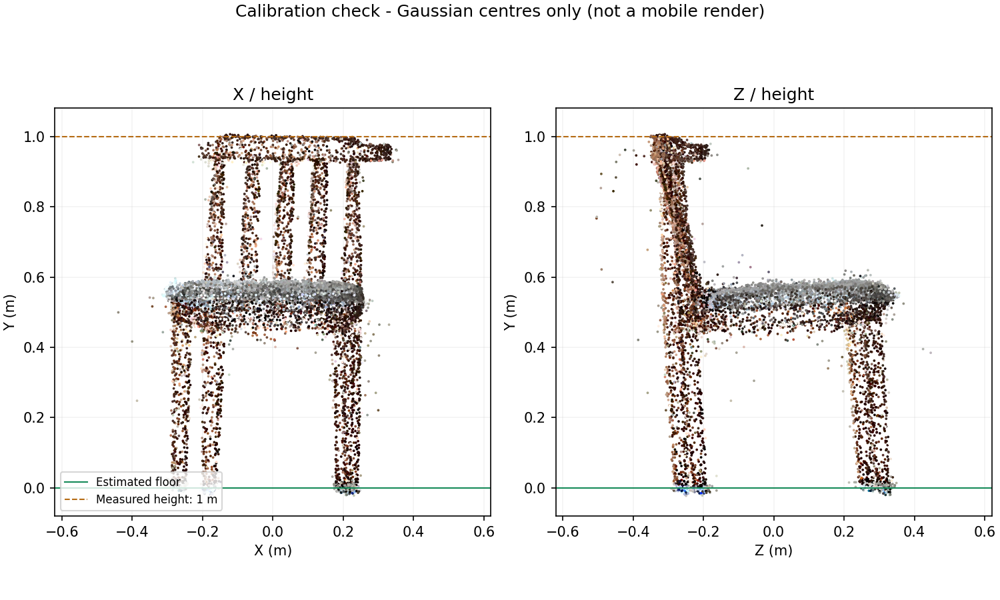

# 第一件真实家具重建结果

2026-10-20 已完成本地 **原视频 → 抽帧 → COLMAP → Brush 3DGS → Gaussian PLY** 的真实流程。

## 文件

- 输入：`input/2d2b9a91aaef59567a4ee2727c2a7090.mp4`
- 模型：[model.ply](runs/furniture-470cc7e52c525dbe/model.ply)
- 对比预览：[reconstruction-preview.jpg](runs/furniture-470cc7e52c525dbe/reconstruction-preview.jpg)
- 执行记录：[run.json](runs/furniture-470cc7e52c525dbe/run.json)
- 渲染检查：[inspection-report.json](runs/furniture-470cc7e52c525dbe/inspection-report.json)

## 实际结果

| 项目 | 结果 |
| --- | --- |
| 视频 | 31.77 秒，720×1280，30fps，HEVC |
| 抽帧 | 100 张，576×1024 |
| 相机恢复 | 100/100 张，属于同一个模型 |
| 训练 | 7000 步，SH degree 2，RTX 4060 Laptop GPU |
| 高斯数量 | 39490 |
| PLY 大小 | 6003505 字节，约 6.0 MB |
| 成功尝试总耗时 | 156.55 秒（不含前一次失败与渲染检查） |
| COLMAP / 训练耗时 | 55.10 秒 / 100.93 秒 |

最初的默认特征设置只连接了 34/100 张图片，脚本按门槛停止，没有训练残缺模型。后续针对弱纹理素材使用更敏感的 SIFT、仿射形状估计、domain size pooling、guided matching 与 SIMPLE_RADIAL 相机，成功恢复全部图片。原视频、第一轮日志和本次参数均保留，没有要求重新拍摄。

## 看到了什么

下面上排是去畸变后的拍摄画面，下排是从 Gaussian PLY 实际渲染的对应视角。椅背、坐垫和椅腿在这些视角下均可辨认；部分边缘、纹理细节和背景仍有模糊。

四个原拍摄视角的回看指标为 PSNR 30.19 dB、SSIM 0.938。这些图片也参与过模型训练，**只用于回看检查，不能作为独立测试集或未见视角的质量证明**。检查过程未覆盖全部自由观察角度。

Brush 检查导出与原模型的全部 Gaussian 字段差在 `1e-6` 内，最大差 `2.384e-7`；位置、尺度、透明度未变。源 `model.ply` 没有被检查步骤覆盖。

## 当前边界与下一步

本阶段的真实重建已跑通，暂时不需要重拍。原始 `model.ply` 是包含房间背景的 3D Gaussian 场景；后续单独提取的结果见下方，它们都不是网格模型。

后续需要进一步清理边缘杂点、校准方向和真实尺寸，再接入手机端显示与 AR 放置。未拍到的底部不保证完整；手机安装与 AR 实测尚未进行。

## 单独椅子初版

已用四个视角的人工椅子轮廓与 COLMAP 相机位姿筛选三维高斯，另存为 [chair.ply](runs/furniture-470cc7e52c525dbe/chair.ply)。保留 **9880 个高斯、1502784 字节（约 1.5 MB）**，源模型保留不变。双击项目里的 **预览纯椅子模型.cmd** 即可打开。

四个原拍摄视角中已去除房间背景，椅背、坐垫、椅腿均保留。椅脚附近仍有少量亮边/晕影和杂点，部分边缘模糊；本次是可预览的独立 Gaussian 资产初版，不代表所有角度都已达到最终展示质量。黑色是渲染背景，未生成黑色背景平面。

标注和筛选针对本次素材，不是通用的自动家具分割功能。筛选结果、原模型哈希和参数见 [chair-extraction-report.json](runs/furniture-470cc7e52c525dbe/chair-extraction-report.json)。裁剪模型和原整幅房间照片的 PSNR/SSIM 因背景差异不具备独立椅子的质量解释。

## 手机资产准备（2026-10-31）

用户提供测试手机为小米 17 Pro、椅子总高 1 米。已生成 [校准配置](mobile-assets/chair-1m/calibration.json) 和原样复制的独立椅子 PLY，详见 [资产说明](mobile-assets/chair-1m/说明.md)。通过附近地面拟合估计方向和地面，以稳健顶部高度设置等比缩放；这是近似校准。正交性、正逆变换、标定高度与模型复制一致性检查通过。

校准保存在配置中，未直接写入 PLY；后续查看器需整体应用变换。独立打开 PLY 不会自动应用尺寸配置。脚边杂点仍保留。尚未生成 APK，手机渲染与 AR 未实测。

## 安卓测试 App（2026-10-31）

已生成 [ChairPreview.apk](dist/ChairPreview.apk)，约 1.8 MB。原生 Java/OpenGL ES 3.0 实现椅子的高斯渲染，复用 Google ARCore SDK 接入可选 AR 模式；本版未采用 Unity。打包时将完整协方差和位置转换为米制坐标，保留 SH degree 2 颜色，以原始坐标的视线求值。渲染和手势在安卓模拟器中实际运行并检查截图，不再只是电脑端 Brush 预览。

实际测试通过：模型加载、单指旋转、双指缩放、重置、AR 服务不可用时返回普通预览。包签名、ZIP 对齐和 arm64 库 16KB LOAD 对齐检查通过。测试结果见 [test-report.json](dist/test-report.json)，说明见 [android-app/README.md](android-app/README.md)。真实手机显示性能、AR 相机、平面识别、锚点与 AR 手势尚待小米 17 Pro 实机测试。

## 安卓 v0.2：尺寸、锁定与遮挡

已新增厘米长宽高输入与保存，三轴分别匹配或按高度等比缩放；AR 取消手势缩放。点击地面放置后自动锁定，解锁才能改位置、方向或尺寸。

已接入 ARCore AUTOMATIC 深度与毫米深度图遮挡：前方实物逐像素遮住高斯，缺失深度时清楚提示。模拟器已通过真实片元渲染的近、远、半幅、无效深度检查及深度行步长处理、尺寸变换与锁定操作检查；这是合成深度测试，手机真实遮挡待实测确认。

v0.2 已更新安装到用户的小米 17 Pro。详情见 [最新测试记录](dist/v02-instrumentation.txt) 与 [尺寸界面截图](dist/v02-test-dimensions-dialog.png)。

用户随后在小米 17 Pro 实际测试并反馈「已开启，遮挡正常」，确认真实场景深度遮挡可用。尺寸数值及锁定通过代码与模拟器测试，实物尺寸准确度尚未独立测量。

用户后续指出尺寸仍偏小、遮挡有时不稳定，因而继续实现 v0.3：可见轮廓标定、等比拟合、尺度对照框/1 米尺、运动补偿与逐像素高斯有效深度。39 项模拟器测试通过，已更新手机；手机已收到稳定化深度并成功放置，实际改善仍待实景反馈。详见 [v0.3 记录](手机模型交互改进-v03.md)。

后续真实反馈：v0.3「尺寸没问题」，但遮挡变差、边缘马赛克明显。已推出 v0.3.1，保留该尺寸版本，关闭实验融合/高斯峰值深度，恢复遮挡基线并提供边缘平滑开关；单独改善场景深度展示。40 项模拟器检查通过并更新手机，等待实景遮挡 A/B 反馈。尺寸通过不等于精密测量达标，实验组件测试通过也不等于实景效果通过。
